<picture>
  <source media="(prefers-color-scheme: dark)" srcset="assets/hero.svg">
  <source media="(prefers-color-scheme: light)" srcset="assets/hero-light.svg">
  
</picture>

  <a href="https://github.com/Aryan10Ben?tab=repositories"><strong>Projects</strong></a> &nbsp;✦&nbsp;
  <a href="resume.md"><strong>Resume</strong></a> &nbsp;✦&nbsp;
  <a href="https://www.linkedin.com/in/aryan-kumar-7847b61b2/"><strong>LinkedIn</strong></a> &nbsp;✦&nbsp;
  <a href="https://github.com/Aryan10Ben"><strong>GitHub</strong></a>

<picture>
  <source media="(prefers-color-scheme: dark)" srcset="assets/motion-abstract.svg">
  <source media="(prefers-color-scheme: light)" srcset="assets/motion-abstract-light.svg">
  
</picture>
  
<picture>
  <source media="(prefers-color-scheme: dark)" srcset="assets/card-about.svg">
  <source media="(prefers-color-scheme: light)" srcset="assets/card-about-light.svg">
  
</picture>
  
<picture>
  <source media="(prefers-color-scheme: dark)" srcset="assets/card-experience.svg">
  <source media="(prefers-color-scheme: light)" srcset="assets/card-experience-light.svg">
  
</picture>
  
<picture>
  <source media="(prefers-color-scheme: dark)" srcset="assets/section-stack.svg">
  <source media="(prefers-color-scheme: light)" srcset="assets/section-stack-light.svg">
  
</picture>

<table align="center">
<tr>
<td align="center"></td>
<td align="center"></td>
<td align="center"></td>
<td align="center"></td>
<td align="center"></td>
<td align="center"></td>
</tr>
<tr>
<td align="center"></td>
<td align="center"></td>
<td align="center"></td>
<td align="center"></td>
<td align="center"></td>
<td align="center"></td>
</tr>
<tr>
<td align="center"></td>
<td align="center"></td>
<td align="center"></td>
<td align="center"></td>
<td align="center"></td>
<td align="center"></td>
</tr>
</table>

RAG · FAISS · REST APIs · SQL · DSA · OOP · DBMS

<picture>
  <source media="(prefers-color-scheme: dark)" srcset="assets/section-cp.svg">
  <source media="(prefers-color-scheme: light)" srcset="assets/section-cp-light.svg">
  
</picture>

<table align="center"><tr>
<td align="center"></td>
<td align="center"></td>
<td align="center"></td>
</tr></table>

  

<picture>
  <source media="(prefers-color-scheme: dark)" srcset="assets/card-cp-text.svg">
  <source media="(prefers-color-scheme: light)" srcset="assets/card-cp-text-light.svg">
  
</picture>
  
<picture>
  <source media="(prefers-color-scheme: dark)" srcset="assets/github-contribution-grid-snake-dark.svg">
  <source media="(prefers-color-scheme: light)" srcset="assets/github-contribution-grid-snake.svg">
  
</picture>

<!-- Layout inspiration: https://github.com/gourabsingha1/gourabsingha1 ; custom SVG implementation. -->
